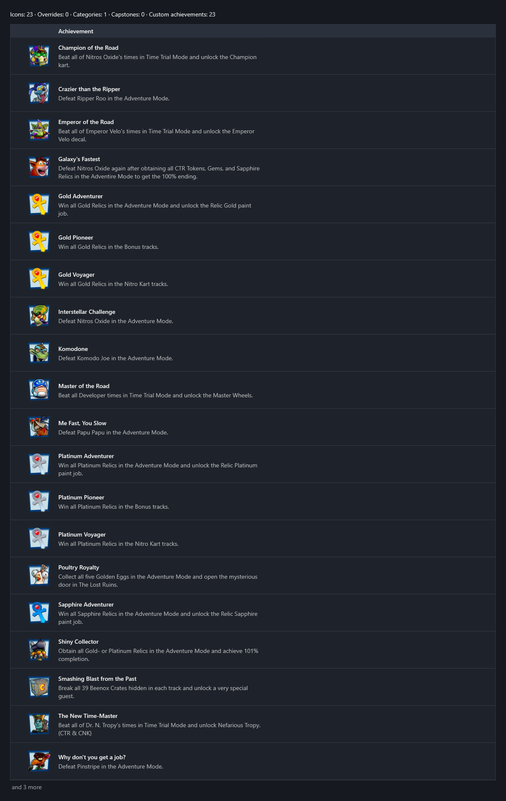

<!-- workshop:images -->

<!-- /workshop:images -->

Most achievements can be tracked using the in-game menus, such as the Adventure Mode save file and the stars in Local Arcade modes. However, the game does not track the Relics earned in Local Arcade Relic Race. You will have to track your completion of these yourself or compare the Highscores menu with the Relic requirements.
The PS4 exclusive 'Retro Stadium' track is not required for any of the unlockables or achievements, and will instead count towards your completion of Turbo Track.
