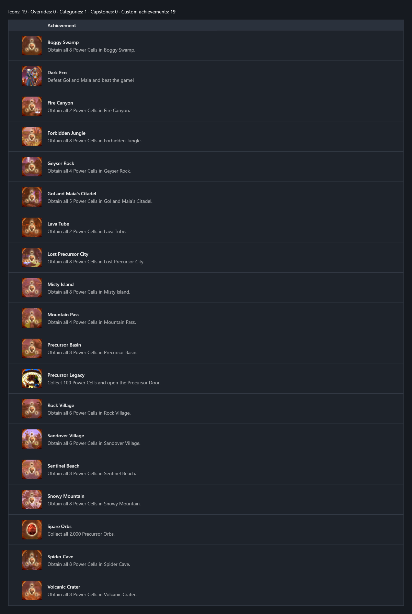

<!-- workshop:images -->

<!-- /workshop:images -->

# Jak and Daxter: The Precursor Legacy (OpenGOAL)

Custom/manual achievements for Jak and Daxter: The Precursor Legacy through OpenGOAL, the playable fanmade recompilation/PC port of the original engine used for the Jak trilogy.
Achievements primarily based on level completion, achievement progress can be checked through the pause menu's level overview and file select screen.
