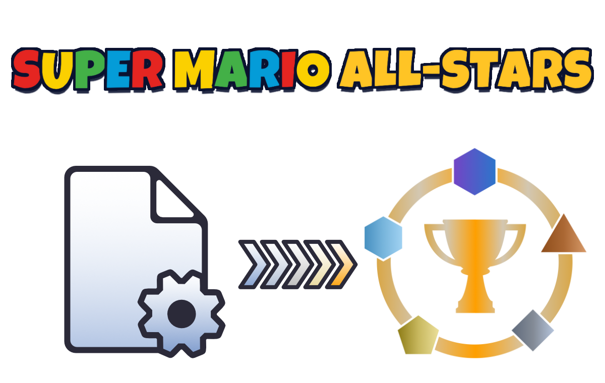
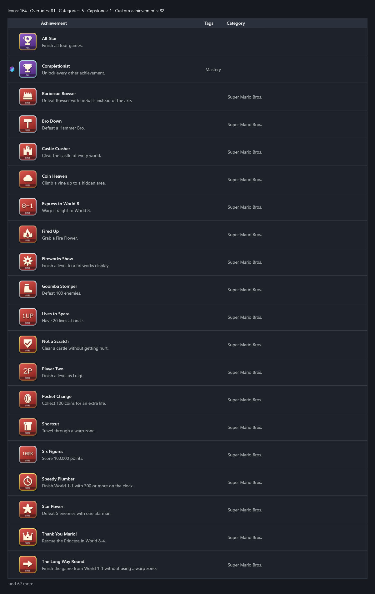

<!-- workshop:images -->

<!-- /workshop:images -->

Instructions: From the achievement editor, go to link file, then browse to your Super Mario All-Stars installation folder and navigate to achievements.ini
Select achievements.ini and hit 'Apply', the editor should link each achievement directly to the file.
