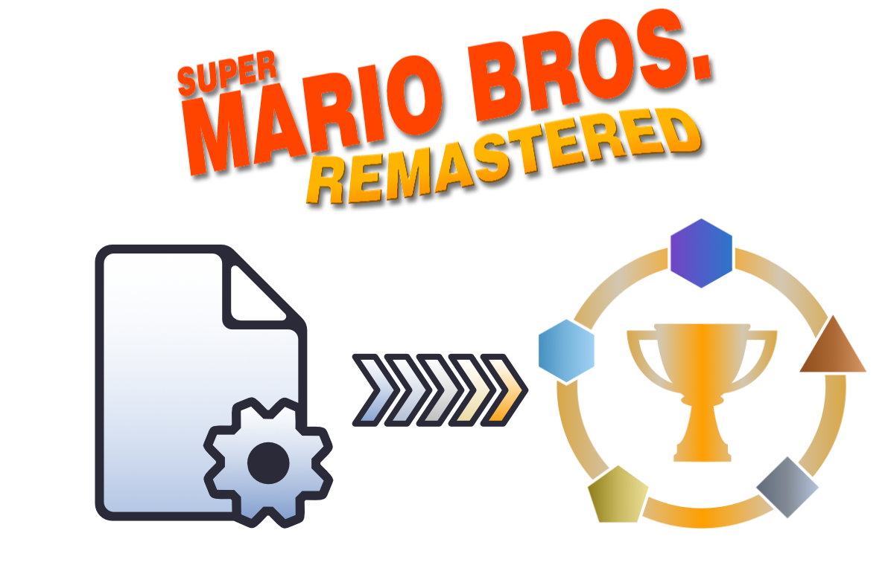
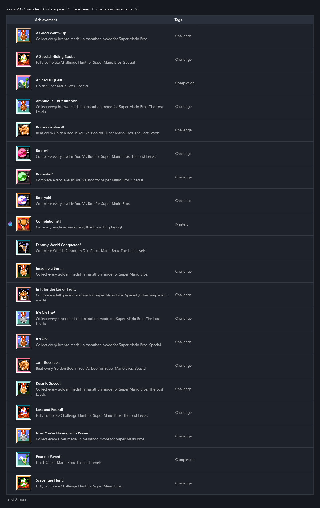

<!-- workshop:images -->

<!-- /workshop:images -->

Instructions: From the achievement editor, go to link file, then browse to your User folder or AppData folder and navigate to AppData\Roaming\SMB1R\achievements.sav
Select achievements.sav and hit 'Apply', the editor should link each achievement directly to the file.
