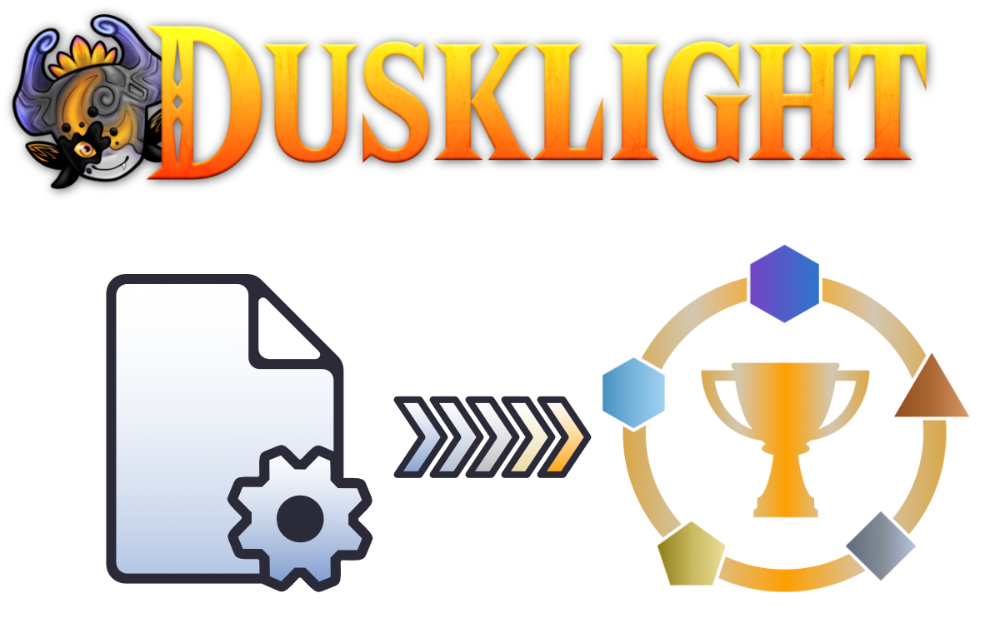
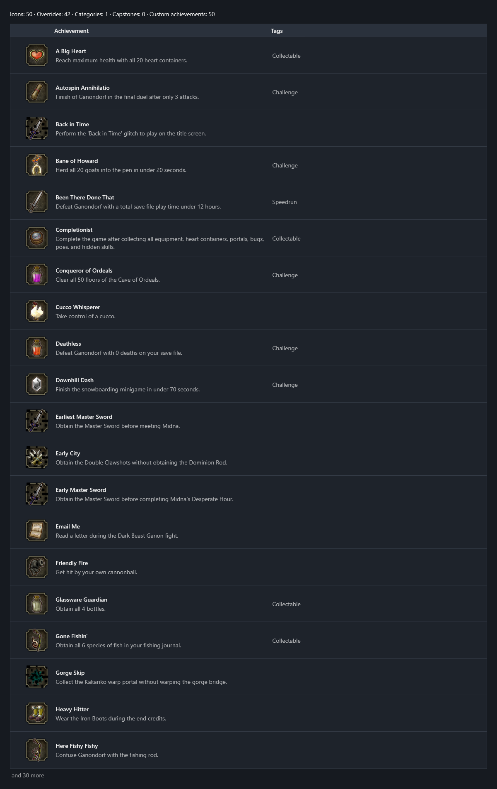

<!-- workshop:images -->

<!-- /workshop:images -->

Instructions: From the achievement editor, go to link file, then browse to your Dusklight installation folder and navigate to \data\achievements.json
Select achievements.json and hit 'Apply', the editor should link each achievement directly to the file.
