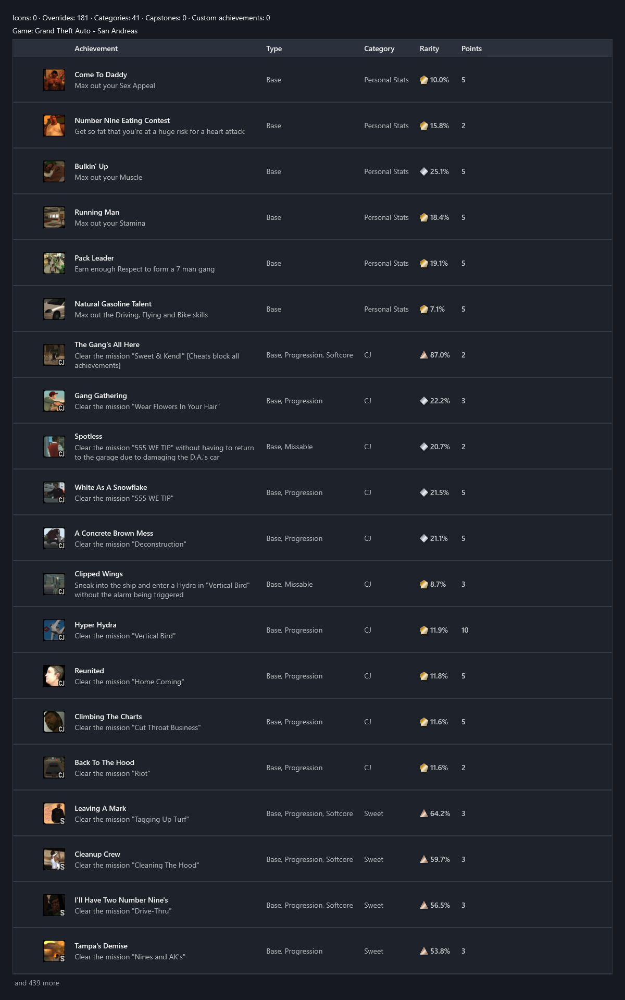

<!-- workshop:images -->

<!-- /workshop:images -->

Again, you require PCSX2 and proper logging in with it to the RetroAchievements API. All art is sourced, again, from the GTA Wiki - there it is tagged as CC BY-NC-SA 3.0.
