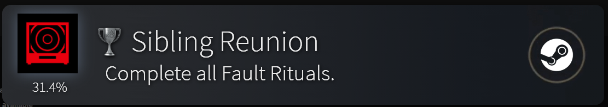

<!-- Generated by tools/Validator build-index; edits are overwritten. -->
# Notifications

Looks for the unlock notification: colors, layout, badges, backgrounds, and optionally a custom template. Install from the Workshop in Playnite, or download the `.panotif` from the item's release and import it under Settings > Notifications > Appearance.

1 item(s), most installed first.

| | Name | Author | Version | Installs | Likes | Updated |
|---|---|---|---|---:|---:|---|
|  | [Steamstation 5](steamstation-5/) | Luxas | 1.0.1 | 76 | 10 | 2026-10-07 |
